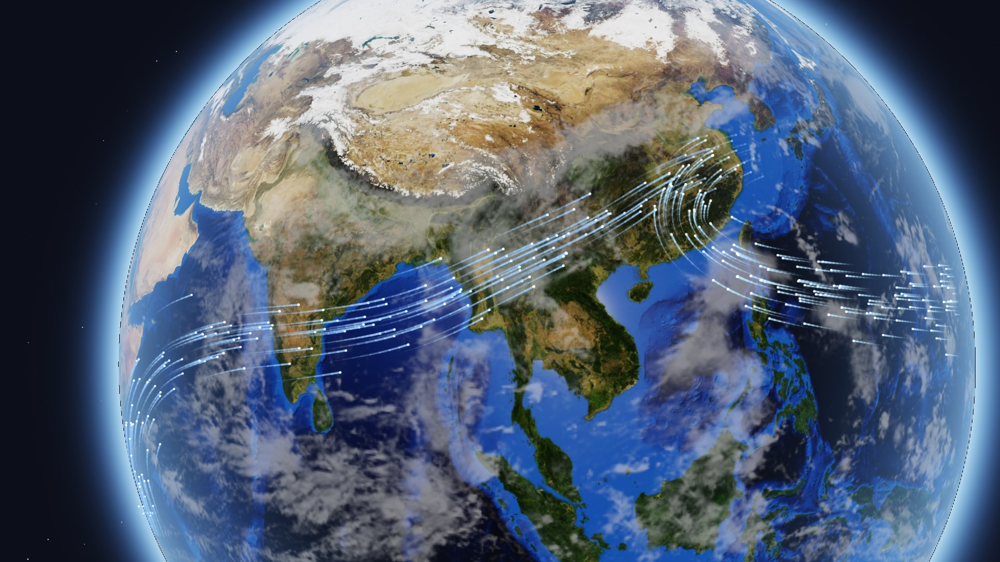
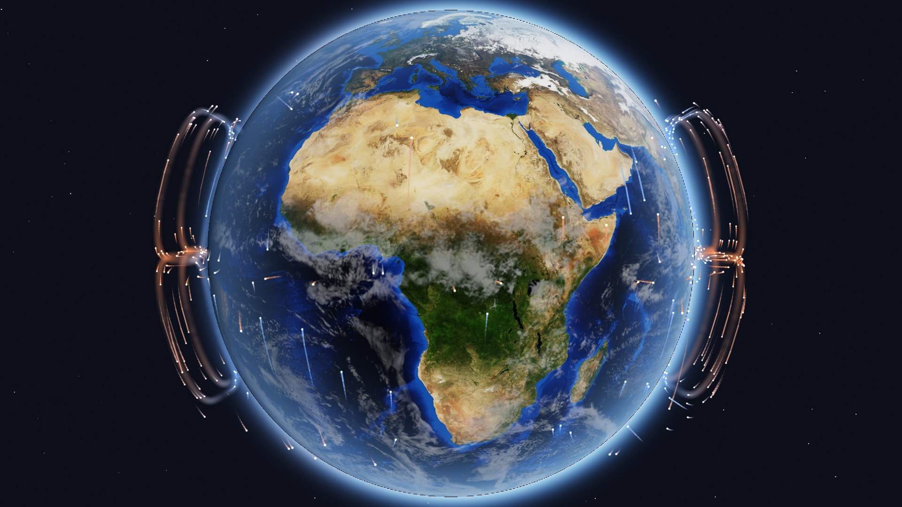
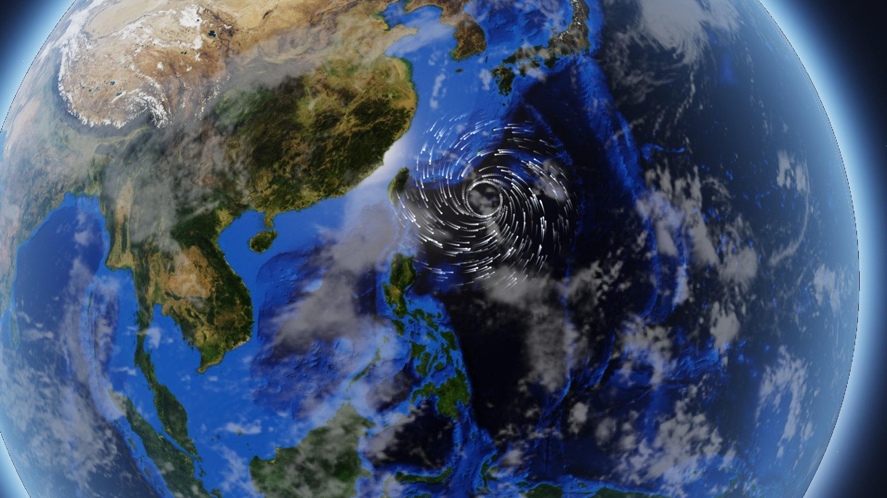
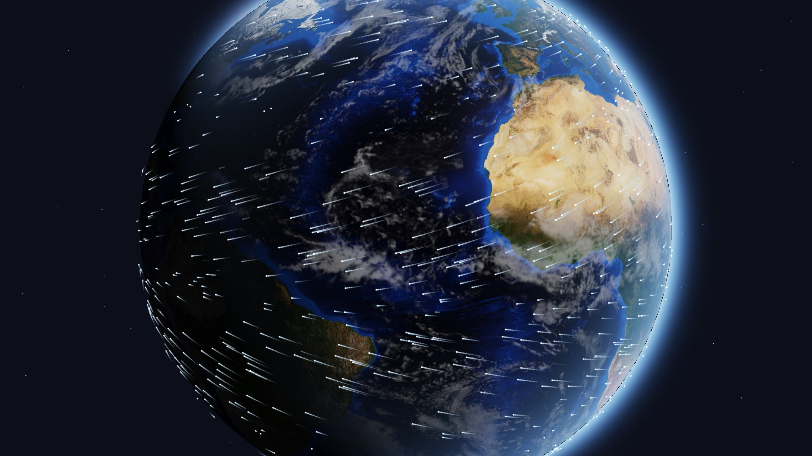
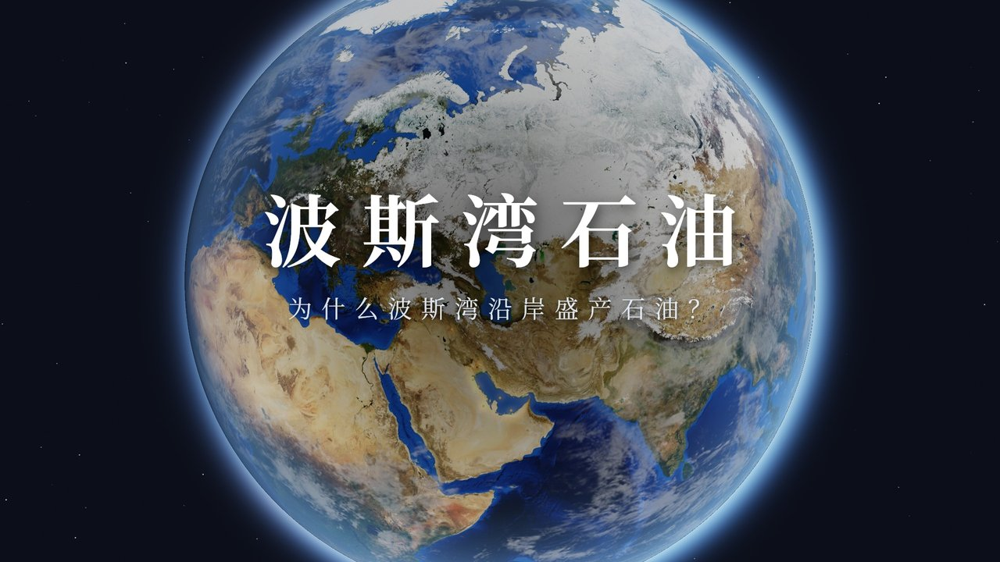
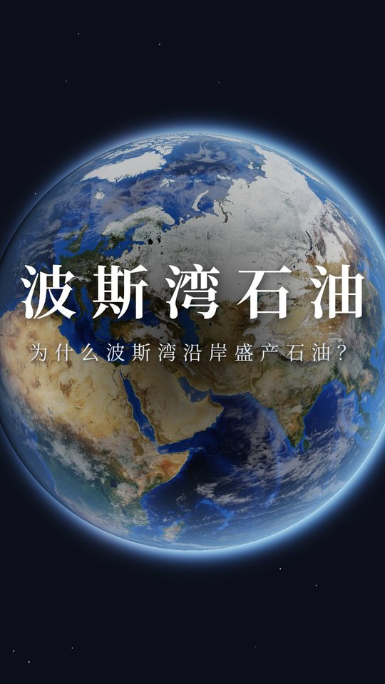
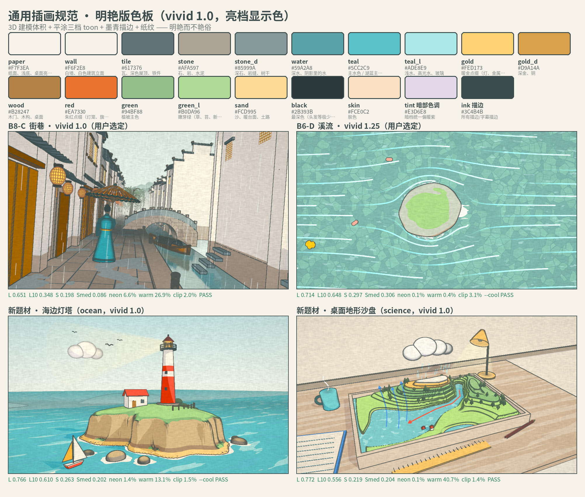

# 3D-Earth · 代码生成的 3D 地球

用 Python + moderngl（GLSL 片元着色器）**逐像素光线求交**渲染的 3D 地球，来自科普视频《为什么撒哈拉曾经是绿色的》。不需要 3D 建模软件，一个 Python 进程离屏（无窗口）就能出 1920×1080 的画面，适合批量渲染视频帧和封面。

## 特性

- **光线追踪球体**：每个像素从相机发出一条光线，与单位球解析求交，没有多边形网格，边缘永远是圆的。
- **真实卫星贴图**：NASA Blue Marble 卫星影像（等经纬度投影），伽马校正后做光照。
- **陆地掩膜**：贴图的 Alpha 通道区分陆地和海洋，用于海面高光、陆地凹凸等。
- **云层**：NASA 云图，可调透明度，随时间 `t` 缓慢漂移，并在地面投下云影。
- **大气光晕**：球面边缘的蓝色菲涅尔边缘光，加上球外的大气辉光（朝阳一侧更亮，晨昏线带一点暖色）。
- **凹凸（bump）**：用贴图亮度的梯度扰动陆地法线，山脉有立体感。
- **海面高光**：太阳在海面上的镜面反射。
- **星空背景**：程序生成的稀疏星点。
- **太阳方向**：任意方向的平行光，自动形成昼夜交界和夜面微光。
- **相机**：`look_at` 相机，可设位置、目标、视场角；`project()` 把 3D 点投影成屏幕坐标，便于在画面上叠加标注。
- **ACES 色调映射 + 抖动**，减少色带。
- 视频专用的示意效果（默认关闭）：绿色撒哈拉、古湖泊、季风雨带、经纬网格。
- `wind.py`：彗星状气流粒子，可以画季风、风场、台风螺旋和哈德来这类垂直环流（见下文）。
- `transition.py`：与渲染器无关的"匹配视角交叉溶解"转场模板（只依赖 numpy），可用来做两个镜头之间的匹配剪辑。

## 安装

需要 Python 3.9+ 和支持 OpenGL 3.3 的环境（有显卡驱动的桌面，或 Linux 上的 Mesa/EGL 软件渲染均可）。

```bash
git clone https://github.com/wsk-builds/3D-Earth.git
cd 3D-Earth
python -m venv venv && source venv/bin/activate
pip install -r requirements.txt
python textures.py        # 把 tex_b64/ 里的贴图解码到 tex/（首次渲染时也会自动执行）
```

> 为什么贴图是 base64 文本？这个仓库是通过只支持文本文件的接口上传的，所以二进制图片被编码成 `tex_b64/*.b64.partNN`。`textures.py` 会把它们还原成 `tex/earth_rgb.jpg`、`tex/land_mask.png`、`tex/cloud_combined_2048.jpg`。

导出视频需要系统里装有 `ffmpeg`（可选，没有的话示例会导出 GIF）。

## 使用

```bash
python example.py                  # out/still.png（静帧）+ out/orbit.mp4（短环绕镜头）
python example.py --ss 0.5         # 半分辨率快速预览
python example.py --frames 120     # 更长的环绕
EARTH_W=1080 EARTH_H=1920 python example.py   # 竖版画幅
```

在自己的代码里：

```python
from PIL import Image
from globe import Globe
from cam import Cam, sph

g = Globe(ss=1.0)                                   # 创建渲染器并加载贴图（只需一次）
cam = Cam(eye=tuple(sph(20, 15, 2.6)),              # 相机在北纬 20°、东经 15°，距地心 2.6 个地球半径
          tgt=(0, 0, 0), fov=35)
img = g.render(cam, t=0.0, sun=tuple(sph(25, 40)), cloud_a=0.8)   # 返回 HxWx4 uint8
Image.fromarray(img[:, :, :3]).save('earth.png')

x, y, depth = cam.project(sph(30, 31))              # 开罗在屏幕上的位置（depth>0 表示在相机前方）
```

坐标约定：地球半径为 1，地心在原点，`y` 轴指向北极；`sph(lat, lon, r)` 把纬度、经度（度）和半径转成三维坐标，经度 0° 朝 `+z`，东经朝 `+x`。

## 参数

`Globe(ss=1.0)`：`ss` 是渲染缩放，输出尺寸为 `cam.W*ss × cam.H*ss`（`ss=2` 可做超采样后再缩小）。

`Globe.render(cam, ...)`：

| 参数 | 默认 | 说明 |
| --- | --- | --- |
| `t` | 0.0 | 时间（秒），驱动云层漂移和噪声 |
| `sun` | (0.6, 0.3, 0.75) | 太阳方向（会自动归一化），可用 `sph(lat, lon)` |
| `cloud_a` | 1.0 | 云层不透明度，0 = 无云 |
| `night` | 1.0 | 夜面微光强度 |
| `atmo` | 1.0 | 大气边缘光 / 光晕强度 |
| `exposure` | 1.0 | 曝光 |
| `star_a` | 1.0 | 星空亮度 |
| `land_dim` | 1.0 | 陆地亮度系数（压暗陆地突出叠加层时用） |
| `spin` | 0.0 | 地球绕地轴自转角（度） |
| `grid_a` | 0.0 | 经纬网格（10° 间隔）透明度 |
| `green` | 0.0 | 示意：撒哈拉变绿程度 0–1 |
| `lake_a` | 0.0 | 示意：古乍得湖等古湖泊 |
| `rain_a`, `rain_lat` | 0.0, 10.0 | 示意：北非季风雨带强度和所在纬度 |
| `desert_a` | 0.0 | 示意：沙漠暖色加强 |

`Cam(eye, tgt, fov=35.0, up=(0,1,0))`：相机位置、注视点、垂直视场角（度）。

环境变量：`EARTH_W` / `EARTH_H`（画幅，默认 1920×1080，需在 import 之前设置）、`EARTH_TEX_DIR`（贴图目录，默认是代码旁的 `tex/`）。

## 风：彗星状气流粒子（`wind.py`）

来自科普视频《北纬30度》的哈德来环流和季风水汽镜头。用来在地球上表示风、季风、洋流、急流、台风这类"流动"：一根根细线带着亮头往前走，尾巴由粗到细、由实到虚。

| 季风（`PathFlow`） | 哈德来环流（`VerticalLoops`） |
| --- | --- |
|  |  |
| **台风（`Typhoon`）** | **风场（`FieldFlow`）** |
|  |  |

```bash
python example_wind.py                  # out/wind_monsoon.png、wind_hadley.png、wind_typhoon.png、wind_field.png
python example_wind.py --video          # 另外输出每个场景 4 秒的 mp4（需要 ffmpeg）
python example_wind.py --only typhoon --ss 0.5
```

### 原理

1. **粒子在 3D 里**：每个粒子是一串世界坐标点（尾→头 `K` 个），位于地表上方 `alt` 处（单位是地球半径，`0.012` ≈ 76 km，示意高度），用 `llr(lat, lon, alt)` 换成三维坐标。
2. **路径怎么来**：
   - `PathFlow`：你给经纬度折线，先用 Chaikin 圆角平滑，再按球面弧长等距重采样。每个粒子有固定的横向偏移（正态分布，沿路径法向），越靠近终点越收拢。
   - `FieldFlow`：你给风场函数 `(lat, lon) -> (u, v)`，粒子从种子点出发用 RK2 积分。
   - `Typhoon`：在气旋中心的局部平面里用极坐标积分。切向速度是修正兰金涡（眼墙内线性、眼墙外按 r^-0.5 衰减），外围按流入角向内螺旋，到眼墙附近停止流入、绕圈，中心留出风眼。北半球逆时针、南半球顺时针。
   - `VerticalLoops`：粒子在"纬度-高度"平面里绕一个圆角矩形的环（超椭圆）：在上升纬度升起，高空流向下沉纬度，下沉，再贴地流回；每绕一圈还向东漂移几度，所以环是立体的。
3. **随时间推进且不闪烁**：一切只由时间 `t` 决定，没有逐帧随机数。沿路径的粒子位置是 `(初相位 + t × 速度) mod 1`。风场和台风粒子按寿命 `life` 循环重生，重生位置用 `(粒子编号, 重生次数)` 的哈希决定。积分步长取"年龄 / 步数"，所以头部位置随 `t` 连续变化。出生和消亡时都有淡入淡出，循环接缝看不出来。同一个 `t` 永远画出同一帧，可以分块并行、断点续渲。
4. **尾巴怎么画**：用 skia 在屏幕空间把相邻两点连成圆头线段。透明度沿尾巴按 `(k/K)^taper` 增大（`taper` 默认 1.3），线宽从 35% 增大到 100%，再加 0.3–1 px 的轻微模糊，让线条更柔和。头部是一个小圆点，用加色混合（`kPlus`）略微提亮。尾巴默认用普通 alpha 叠加而不是加色，粒子密集处不会糊成一片刺眼的白光。外发光 `glow` 默认是 0。
5. **透视**：线宽乘以 `(相机到地表的距离) / (该点深度)`，近处粗、远处细。
6. **遮挡**：每个点都从相机向它做一次光线-单位球求交，被地球挡住的线段不画。转到地球背面的粒子会自然消失，高出地表的环流在边缘处仍然可见（见哈德来示意图两侧的环）。

### 用法

```python
import numpy as np
from globe import Globe
from cam import Cam, sph
import wind

g = Globe(ss=1.0)
cam = Cam(tuple(sph(15, 101, 2.35)), (0, 0, 0), fov=35)

monsoon = wind.PathFlow(
    [[(-12, 52), (8, 56), (15, 80), (21, 97), (29, 113), (32, 126)],      # 印度洋 → 东亚
     [(14, 152), (18, 128), (24, 114), (31, 119), (32.5, 126)]],          # 太平洋 → 东亚
    weights=[.58, .42], colors=['#9fd0ff', '#b9e6ff'])
typhoon = wind.Typhoon(center=(22.5, 128.0), radius=8, rmax=1.3, eye=.55)
hadley = wind.VerticalLoops(lat_rise=0, lat_sink=30, lon_clusters=((-88, 16), (92, 16)))
trades = wind.FieldFlow(lambda lat, lon: (-4 * np.cos(np.radians(lat)), 0 * lat), region=(0, 30, 100, 180))

for i in range(120):
    t = i / 30
    base = g.render(cam, t=t, sun=tuple(sph(21, 107)), cloud_a=.16)
    frame = wind.composite(base, cam, [monsoon, typhoon], t=t)       # HxWx4 uint8
```

也可以在自己的 skia 画布上直接画：`layer.draw(canvas, cam, t, alpha)`，`alpha` 用来做淡入淡出。最底层的 `wind.draw_streaks(canvas, cam, pos, rgb, alpha, ...)` 接受任意 `(N, K, 3)` 的 3D 折线。

### 参数

所有图层都有的样式参数：

| 参数 | 默认 | 说明 |
| --- | --- | --- |
| `width` | 3–3.6 | 线宽（像素，按透视缩放） |
| `blur` | 0.4–0.6 | 尾巴的模糊半径（像素） |
| `opacity` | 0.72–0.85 | 整体不透明度 |
| `head`, `head_alpha` | True, 0.55 | 是否画头部亮点和它的亮度 |
| `taper` | 1.3 | 尾巴淡出的幂次，越大尾巴越短、越虚 |
| `glow` | 0.0 | 外发光（加色、模糊的宽线），0.15–0.3 是很淡的光晕 |
| `additive` | False | 尾巴是否用加色混合 |
| `alt` | 0.012–0.014 | 离地高度（地球半径） |
| `seed` | — | 随机种子，换一个就是另一组粒子 |

各图层特有的参数：

- `PathFlow(paths, weights, colors, n=340, speed=(.07,.10), tail=.08, K=10, spread=2.6, converge=.6, smooth=3, fade=(.06,.15))`：`speed` 是每秒走完路径的比例，`tail` 是尾长占路径的比例，`spread` 是路径两侧散开的程度（度）。
- `FieldFlow(field, region, n=600, life=4, tail=.6, steps=24, color)`：`field` 返回东向、北向速度（度/秒），`tail` 的单位是秒；`color` 可以是 `callable(风速) -> rgb`。
- `Typhoon(center, radius=8, rmax=1.4, eye=.6, inflow=24, vmax=2.6, spin=None, bands=3, band_depth=.8, core_opacity=.4, n=560, life=4.5, tail=.8)`：`spin` 默认按半球自动判断；`bands` 是螺旋雨带条数；`core_opacity` 用来压暗眼墙附近最密的粒子。
- `VerticalLoops(lat_rise=0, lat_sink=30, height=.19, base=.012, squareness=.44, hemis=(1,-1), lon_clusters, uniform_frac=1/3, lon_drift=6, speed=(.072,.088), tail=.05, colors=(暖, 冷, 回流), start=None, guide_alpha=0, guide_lons=())`：费雷尔环流可以用 `lat_rise=60, lat_sink=30`；`start` 设一个时间，粒子会从上升支依次放出；`guide_alpha` 会沿环画几条很淡的引导带。

> 环流高度、粒子速度都是**示意**，不是真实数据。真实对流层只有地球半径的约 0.2%，画出来需要大幅夸大。

## 封面规范（`cover/`）

这是地理科普系列横竖版封面的规范，加上一键生成脚本，以《为什么波斯湾沿岸盛产石油？》那期的封面为基准。画面是深空背景，中间一颗 3D 地球，用的就是本仓库的 `globe.py`，自然卫星色、近正面均匀光照，和风流预览图同款，横竖版通用，竖版的地球再略微提亮、提饱和一点；上面一行白色衬线大标题，下面一行问句副标题，文字居中稍偏上。

- 规范文档：[`cover/SPEC.md`](cover/SPEC.md)，写了流程、所有参数、特效写法、检查清单和每期要填的表。
- 生成：`python cover/make_cover.py cover/examples/persian_gulf.json`，同时输出横版 1920×1080 和竖版 1080×1920 的 PNG 和 JPG，放在 `cover/out/` 下。
- 字体需要 Noto Serif CJK SC（Bold + Regular），仓库里没有附带，安装方法见 SPEC §2.4。

> ⚠️ **视角（相机的纬度、经度，横竖版各自的取景）每期都要根据选题单独判断，不能照抄往期的数值。** 脚本里 `lat / lon / dist / ty` 都是必填项，判断方法见 SPEC §3。往期数值只作参考（SPEC §10）。

<p> </p>

## 插画风规范（`illustration/`）

这是地理科普视频里、地球镜头以外的通用插画规范，不限题材。画面在 Blender 里用真 3D 模型搭出来：三档色阶平涂，暗部统一偏暖紫，合成器按法线和深度描一圈墨青色轮廓，最后叠一层纸纹。颜色明艳，大面积仍是浅色、中等饱和，焦点色收着，有体积，也有纸面插画的质感。

<p></p>

- 规范文档：[`illustration/SPEC.md`](illustration/SPEC.md)，写了风格定义、vivid 1.0 / 1.25 两档、亮度、饱和度、暖色占比的可测界线、色板、题材切换、难元素做法和交付清单。
- 一键示例：`"${BLENDER:-blender}" -b --python illustration/example_scene.py -- --pct 50`，成品在 `illustration/out/example.png`。灯塔和沙盘用同样的方式跑 `illustration/scenes/scene_lighthouse.py`、`illustration/scenes/scene_sandbox.py`。脚本会先写出同名的 `*_raw.png`（还没叠纸纹），那是运行时才生成的中间文件，仓库里没有；叠完纸纹的 `out/*.png` 才是成品，四张示例成品已经附在 `illustration/out/`。
- 动画镜头：`python3 illustration/render_anim.py illustration/scenes/anim_sandbox.py --mp4`。一个进程搭一次场景连续渲、默认 4 采样、纸纹批处理、多个 Blender 并行，可断点续渲；8 核 CPU 上 1080p 每帧约 1.4 秒，比逐帧开 Blender 快约 5 倍。场景约定、命令和实测见 [`illustration/SPEC.md`](illustration/SPEC.md) §11。
- 依赖：Blender 3.6（Eevee），仓库不附带，需要自己安装。可执行文件放在 `PATH` 里并命名为 `blender`，或用环境变量 `BLENDER` 指向它。测量成图的 `check_frame.py` 和叠纸纹的 `paper.py` 只用本仓库已有的 numpy、Pillow。

## 背景音乐规范（`audio/`）

科普视频的背景音乐规范。默认背景音乐是《千年之后（氛围版）》；视频前 10 秒只有背景音乐、没有其他音效。

- 规范文档：[`audio/SPEC.md`](audio/SPEC.md)，写了默认曲目、响度、混音参数和交付前检查。
- 混音：`python3 audio/mix_bgm.py --sfx <音效混音.wav> --out <最终音轨.wav> --duration <秒>`，默认曲目是同目录的 `qiannian_zhihou_ambient.mp3`。需要系统里的 ffmpeg / ffprobe。

## 文件

| 文件 | 作用 |
| --- | --- |
| `globe.py` | 地球着色器和 `Globe` 渲染器 |
| `cam.py` | 相机、投影、经纬度转坐标 |
| `glcore.py` | moderngl 离屏上下文、全屏 Pass、贴图加载、公共 GLSL（噪声、ACES） |
| `textures.py` | 贴图解码和合成（卫星影像 + 陆地掩膜 → RGBA） |
| `transition.py` | 匹配视角交叉溶解转场模板 |
| `example.py` | 示例：静帧 + 环绕镜头 |
| `wind.py` | 风 / 季风 / 台风 / 环流的彗星状气流粒子 |
| `example_wind.py` | 示例：季风、哈德来环流、台风、风场 |
| `docs/` | 效果预览图 |
| `tex_b64/` | base64 编码的贴图 |
| `cover/` | 封面规范 `SPEC.md`、一键脚本 `make_cover.py`（直接调用根目录的 `globe.py`）、火山点数据、示例配置、反推视角工具、预览图 |
| `illustration/` | 通用插画风规范 `SPEC.md`、Blender 平涂与描边工具、纸纹后期、成图测量、灯塔和沙盘示例场景、色板拼图 `style_sheet.png`、动画渲染器 `render_anim.py` |
| `audio/` | 背景音乐规范 `SPEC.md`、默认背景音乐、一键混音脚本 `mix_bgm.py` |

## 贴图来源与版权

- **地球影像**：NASA Visible Earth，*Blue Marble: Next Generation*，2004 年 12 月，5400×2700（8 km/像素）。
  来源页：<https://visibleearth.nasa.gov/images/74218/december-blue-marble-next-generation/74219l>。
  原视频项目的记录是"NASA Visible Earth Blue Marble（2004 年 12 月）"；具体是带地形/海底地形晕渲的版本还是基础版本，原项目没有记录。
  仓库中的 `earth_rgb.jpg` 是原项目贴图的 JPEG（质量 97，4:4:4）重新编码版本，与原 PNG 渲染结果的逐像素差异平均约 0.1/255（PSNR ≈ 55 dB），肉眼看不出区别。
- **陆地掩膜** `land_mask.png`：原项目贴图的 Alpha 通道（0 海洋 … 255 陆地，边缘有过渡）。它最初是怎么生成的，原项目没有留下记录。
- **云图** `cloud_combined_2048.jpg`：NASA Visible Earth，*Blue Marble: Clouds*（image 57747，2002 年），2048×1024，未做修改（SHA-256 与 NASA 原文件一致）。
  来源页：<https://visibleearth.nasa.gov/images/57747/blue-marble-clouds/77558l>。
  原始文件：<https://eoimages.gsfc.nasa.gov/images/imagerecords/57000/57747/cloud_combined_2048.jpg>

影像来自 NASA Goddard Space Flight Center / NASA Earth Observatory（Reto Stöckli 等）。NASA 影像在美国一般不受版权保护，使用时请注明来源，且不得暗示 NASA 背书，详见 NASA 媒体使用政策：<https://www.nasa.gov/nasa-brand-center/images-and-media/>。

绿色撒哈拉、古湖泊、雨带等效果为**示意**，不是真实数据。
